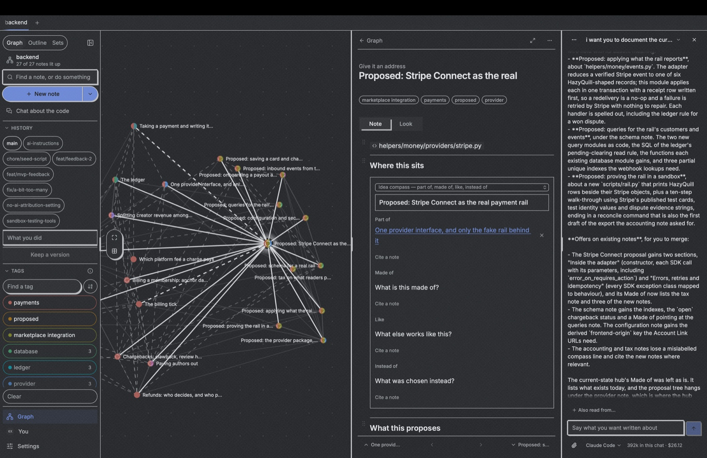
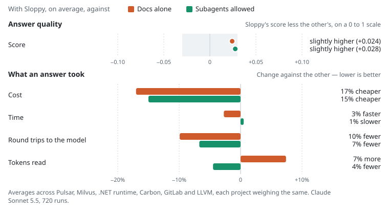
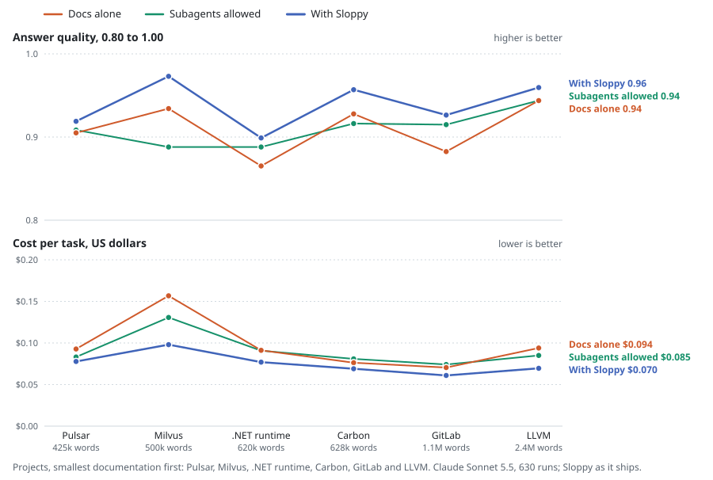
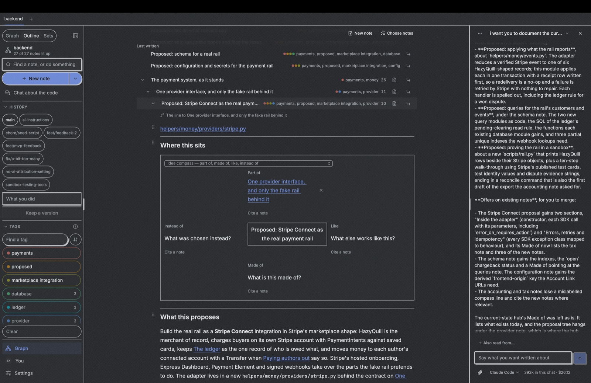

# Sloppy

**Same models, better outputs.** On average across six large codebases, Claude Code with Sloppy scored slightly higher (+0.019) than with the docs alone, cost 20% less, was 2% faster, took 4% fewer round trips to the model and read 24% less new text.

Sloppy keeps the reasons behind your code beside it: a graph of notes, each placed under what it
came out of and pointing at the code it explains, committed with the repository as markdown. The
developers on a project and the AI agents working on it read the same record, so an agent asks
why before it changes anything.



## Built for large codebases

On the six large open-source projects, whose reasons are spread across many design documents, Sloppy comes out
marginally ahead on average: answers score slightly higher, at lower cost. Three of the six are measured
with their documents shaped the way [the practices](bench/WHERE-SLOPPY-HELPS.md) set out, which is how
Sloppy is meant to be taken up; the rest are measured on their documents as they keep them today. On
one of those three the shaping made every reader worse, which is why the practices are published with
that result beside them rather than as advice. On the
small repositories the docs alone already reach the answers, so it has little to add. A seventh project,
with a quarter of the documents the six were chosen at, was measured because it was asked for; it has
its own page and is in no average.

<picture>
  <source media="(prefers-color-scheme: dark)" srcset="docs/images/bench-aggregate-dark.svg">
  
</picture>

\* Text the model had not read before. The conversation it re-reads on every turn is billed at a
fraction of the price, so counting that in would show more text read where the bill is lower.

- **It helps most where the reasons can't be found by file name**: its first answer finds the
  document by the words it shares with the task, and the agent stops early.
- **It helps least where one search already finds the answer**, or where the answer lives in the
  code.
- **It adds little on small repositories**, where the docs alone already reach the answers.

<picture>
  <source media="(prefers-color-scheme: dark)" srcset="docs/images/bench-projects-dark.svg">
  
</picture>

How it was measured: [`bench/REPORT.md`](bench/REPORT.md) · each round:
[`bench/SURVEY.md`](bench/SURVEY.md) · run it yourself: [`bench/README.md`](bench/README.md)

## Try it on your repo

The figures above are averages; your codebase will land somewhere around them. Set it up in three
steps, or [run the same benchmark on it](bench/README.md).

1. From a clone:

   ```sh
   git clone https://github.com/sloppy-sh/sloppy
   cd sloppy && pnpm install && pnpm build:packages
   cd packages/ts/cli && pnpm link --global
   ```

2. In your repository: `sloppy init`
3. Commit this as `.mcp.json`, and your agent reads the graph:

   ```json
   {
     "mcpServers": {
       "sloppy": { "type": "stdio", "command": "sloppy", "args": ["mcp"] }
     }
   }
   ```



## More

- **A notebook drawn as a graph**, where it started: [`docs/STORY.md`](docs/STORY.md)
- **Emoji, 571 colour schemes, signed history** and the rest: [`docs/STORY.md`](docs/STORY.md#what-else-is-in-it)
- **Which projects gain most, and how to shape your notes for Sloppy**: [`bench/WHERE-SLOPPY-HELPS.md`](bench/WHERE-SLOPPY-HELPS.md)
- **This project's own graph**: [`.sloppy/`](.sloppy) · the note format: [`.sloppy/AGENT.md`](.sloppy/AGENT.md)
- **Setup and conventions**: [`CONTRIBUTING.md`](CONTRIBUTING.md) · **architecture**: [`docs/ARCHITECTURE.md`](docs/ARCHITECTURE.md) · **product and design**: [`PRODUCT.md`](PRODUCT.md), [`DESIGN.md`](DESIGN.md) · **the rules every change is held to**: [`AI.md`](AI.md)

## Licence

MIT — see [`LICENSE`](LICENSE).
