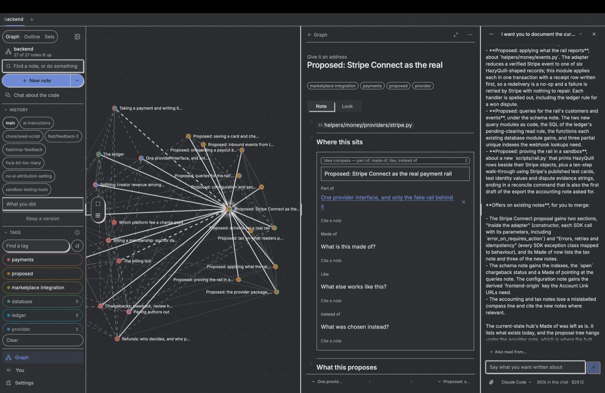
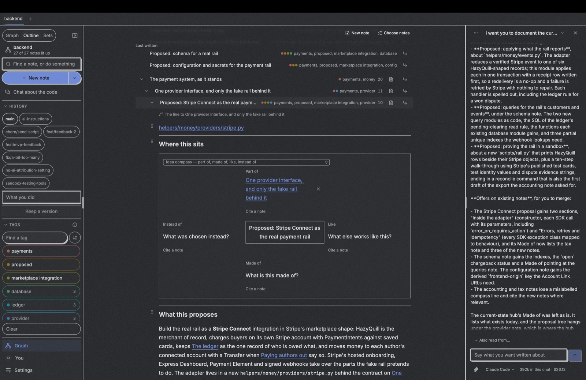
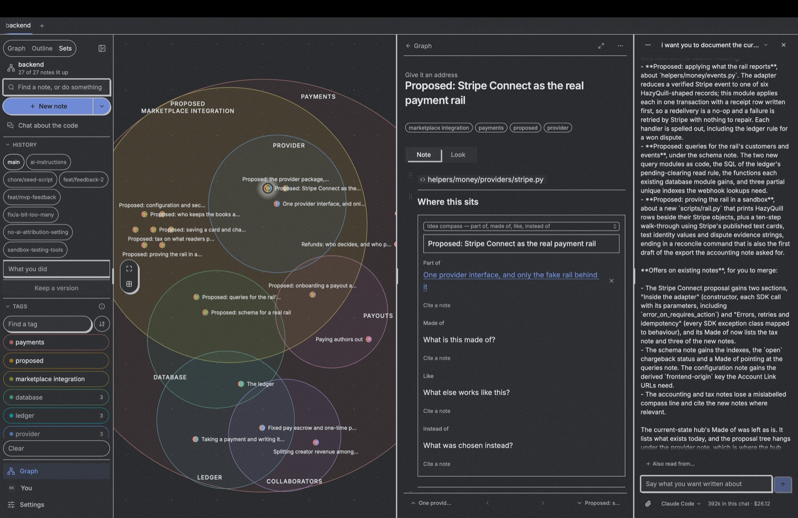

# Sloppy

**A second brain for a project, and the one place the people working on it and the
assistants working beside them keep the same account of what it is for.**

Sloppy is a note-taking app whose notes are a graph: every note knows what it sprang out
of, carries an address you can cite, and wears the tags that put it in a set. Point a
graph at a codebase and it becomes something more particular — the record of _why that
project is the way it is_, written where a person and a machine can both read it, placed
by what each decision came out of rather than filed in a folder somebody invented.



## The problem

Large projects fail at the same two seams.

**Between people.** The reasoning behind a system lives in the heads of whoever built it,
in a chat thread nobody can find, or in a document that stopped being true a year ago.
When those people leave, what arrives in their place is a codebase and no account of it.

**Between people and their assistants.** An agent asked to change something either gets a
prompt somebody typed from memory, or it reads the whole repository and burns its context
discovering what two sentences would have told it. Nobody can see what it was given, so
nobody can check what it did against what it was told.

Sloppy's answer to both is the same: **one graph, shared, that the code is answerable
to.** A note says what a thing is for; the code is what somebody built to do it; either
can be checked against the other, and the answer goes back in the note where the next
reader finds it. The notes are ordinary markdown files in the repository, so they are
reviewed, branched and merged with the code they are about.

## Who it is for

- **People leading a project who want to be answerable for the AI in it.** Not "did the
  model do well" — _what was it told, what did it write, and does the result match what
  the note said the thing was for._ Sloppy makes each of those a thing a person can point
  at, after the fact, without having been in the room.
- **Projects that change hands.** A new lead, a new team, an audit, a handover. The graph
  is what you read instead of interviewing people who have gone: the decisions, under what
  they came out of, each pointing at the code it explains — and a way to propose an edit
  the same afternoon you found the problem.
- **Anyone who wants a second brain.** Without a codebase attached it is a note-taking
  app: a graph of your own thinking, with addresses, tags and a canvas. MIT licensed, and
  your notes are files on your disk.

## What it does

### The notes are files, beside the code

A project's graph is a `.sloppy/` folder in the repository: one markdown file per note,
front matter carrying what it sprang from, its address and its tags. Nothing is locked in
a database somewhere — `grep` works, `git log` works, a pull request shows a decision
changing. `.sloppy/AGENT.md` is the format written out for whatever assistant you set to
work, so an agent with no Sloppy installed still writes notes the app and the next person
read the same way.

A note points at the code it explains, and the app says when that code has moved since its
author last read it — the mark on the canvas carries a dot, and the note is the place to
write down whether it still holds.

### Context-aware chat, one per project



The assistant works **inside the graph it is talking about**. Each project keeps its own
threads; each thread keeps its own draft and its own context, and the dock tells you how
full that context is and what it has cost as you go. You choose the notes a thread reads
rather than pasting them, and what the assistant writes comes back as notes you review
before they land — in a working copy of your folder, merged when you say so, never written
over your files behind your back.

So the chat is not a side channel. What went in is a set of notes anybody can open, and
what came out is a change anybody can read — which is the difference between using AI on a
project and being able to account for it afterwards.

### What an agent is actually given

A chat or a build hands the assistant a small endpoint of Sloppy's own — MCP, on the
loopback, named `sloppy` — and the acts it serves are in the vocabulary of the graph
rather than of the filesystem. That is the whole trick: an agent that can only see files
has to rediscover what the project means every time, while one that can ask the graph gets
the answer somebody already wrote.

**Three acts for reading**, and they are what a session spends its first context on:

| Act            | What it answers                                                                                                                 |
| -------------- | ------------------------------------------------------------------------------------------------------------------------------- |
| `list_notes`   | Every note this project has: its ref, title, address, tags, what it springs out of, **and the places in the code it is about**. |
| `search_notes` | The notes carrying some words, with the writing around what matched.                                                            |
| `read_note`    | One note whole — its sections as markdown, its tags, the code it points at.                                                     |

**Both directions are open, which is the point.** A note carries `code:` anchors — a path,
and a run of lines or the name of a symbol inside it — so the same index answers _"what is
`helpers/money/providers/stripe.py` for?"_ with the note that says so, and _"where is this
decision in the code?"_ with the file. An agent arriving at an unfamiliar system reads the
intent in English and then goes straight to the lines it is about, instead of inferring a
project's purpose from its syntax. A person does the same, from the other end: the note on
the canvas carries the file, and the file's note is one search away.

**Eight more for writing**, and the agent is held to the same rules a person is:
`write_note`, `move_note`, `tag_note`, `number_note`, `link_notes`, `style_edge`,
`style_note`, `delete_note`. The rules ride in the tools' own descriptions, so an agent
reads them before it can call anything:

- **Search before you write.** Where the graph already says a thing, it is cited —
  `[what it is called](sloppy:<ref>)` — not written a second time. This is what stops a
  graph degenerating into forty summaries of the same decision.
- **A reason goes down only from a source you name** — the person's words, a commit, a
  comment, a document in the repository. Where nothing says _why_, the open question goes
  down instead of a guess. An assistant inventing a plausible rationale is the failure mode
  this rule exists for.
- **A relation between two notes goes on the line between them**, not into prose about it,
  and what a line means is written on the line.
- **Answers are bounded.** A long listing says how much of itself it left; a long note says
  how many sections it left. A note is never too long to read, only too long to hand over
  whole — so one act cannot swallow a session's context.

A build adds four more — `plan_build`, `raise_need`, `hand_off`, `review_build` — and
**which acts a session may call is decided by its role**: the one that reads the notes and
plans cannot write code, no role may start sub-agents of its own, and none of them can
reach outside the copy they are working in. Sloppy is the orchestrator, which
is what keeps every context small and every step something you can look at.

The endpoint speaks plain MCP, so an agent you drive yourself can use the same acts.

### Build for me

On a graph pointed at a codebase, pick the notes that say what a piece of the project is
for and press **Build this**. Sloppy then runs the work itself rather than handing one
agent a prompt and hoping:

1. **It reads first, and says what is missing.** A session reads the notes you chose and
   answers with a plan — the tasks, the exact notes each one needs, and the **questions**:
   what the notes do not say that the work has to know, and where two notes disagree with
   each other or with the code. **The agent is expected to dispute the documentation**, and
   the questions stand in front of you as a card.
2. **You answer by writing.** An answer is a note in your own words, under the feature
   where it belongs. The intent gets better because somebody asked a precise question
   about it, and the answer stays after the build is over.
3. **It builds on a line of its own.** One fresh session per task, each given the smallest
   context that can do the work — its notes whole, nothing else of the graph — so no
   session runs degraded and none of them touches your folder. A session that fills up
   hands off to a fresh one instead of quietly getting worse.
4. **It reviews what it wrote**, against the notes rather than against taste, and a
   blocking finding goes back to a fresh session.
5. **You are shown the result and the merges.** What was built, which files, what the
   checks said, what notes were written, what was left undone — and the one question that
   is yours: bring it in, or not. Work on that version first if you want to run it.

Nothing lands on a timer. A task the review cannot settle is marked contested and waits
for you, and the line the build worked on is a real branch you can check out, run, or
throw away.

### Three readings of the same graph



The same notes, read three ways, with nothing hidden in any of them:

- **Graph** — the genealogy. Every note placed by what it sprang out of, so a line of
  thinking is a shape you can see. A subtree folds into one mark and opens on a tap.
- **Outline** — the same tree as rows, with a note's interior opening in place.
- **Sets** — the tags as overlapping places, each note standing where it belongs. A note
  in two sets stands where the two cross; drag it into a place to tag it.

Across all three, **a mark wears a band per set it is in** — so which tags a note carries
is readable from the mark itself, before you have asked anything, and the rail beside the
canvas is the legend. Selecting tags highlights what carries them and dims the rest, so
the shape of the graph survives the question instead of being filtered away.

Every note also carries a **compass** — _part of, made of, like, instead of_ — the four
questions that place an idea against the ideas around it. "Instead of" is where a
rejected option goes, which is the half of a decision most projects lose.

### Versions, lines and proposing an edit

A graph pointed at a codebase keeps that repository's own history, read in the column
beside the notes. Standing on an earlier version is a real checkout you can write from, not
a read-only view: open the project as it was a release ago, write what you found, and that
becomes a line. Bringing a line in is a merge — notes settled note by note, a conflict in
the code refused with words rather than guessed at.

This is the path for somebody who has just inherited a system: read the graph, find the
decision that no longer holds, write the correction where you are standing, and hand back a
line somebody can review.

### An address you can cite

A note's address — `1`, `1a`, `1a1`, `1b` — is the label a person cites it by, the way a
page number works inside a book. The Folgezettel rule offers one when you write a note
under another, so numbering is not work you do; it is yours to change or leave off, and an
address a note has ever carried keeps leading to it, so a citation somebody wrote down a
year ago still lands.

The same rule carries between people: because the shape is derived rather than drawn, a
subtree published from one graph is pulled into somebody else's and lands there looking the
way its author saw it, addresses intact.

### Also at the command line

```bash
sloppy init     # start a graph beside this code
sloppy draft    # write a note from the terminal
sloppy check    # read the notes against the code and say what disagrees
```

## Why not Obsidian, Logseq or Notion

They are good tools, and if what you want is a personal wiki you should use one. Sloppy
exists because three things we needed are structural, not features anybody can bolt on.

**A graph everyone reads the same way.** Obsidian's graph view is decorative, and honestly
so: a mesh of backlinks has no agreed shape, so your graph and mine mean different things
and neither can be handed to the other. In Sloppy what a note sprang out of, and its order
among its siblings, are the protocol — every copy derives the same positions from them, so
a subtree published from one graph lands in somebody else's in the shape its author saw.
Notion solves this by imposing a tree, which means deciding the structure before the
thought exists. The genealogy is the third position: not containment, but _the direction a
thought grew in_.

**An address a decision can be cited by.** `1a1` is a label you can put in a commit
message, a ticket or an argument, and it still resolves after the note has been renamed and
moved. A wiki link that depends on a title breaks the day somebody improves the title.

**Notes that know about code, and an agent that knows about notes.** None of the three
carries an anchor into a file that tells you the code has moved since the note was written,
and none serves an assistant in the vocabulary of notes and refs rather than file paths.
What you can do instead is point an agent at a vault of markdown and hope it reads the
right file; what you get back is summaries written over each other,
no citations, and no way to tell afterwards what it had been given. The acts above are the
answer to that, and they are why the rest of the design holds: a graph only stays worth
reading if what writes into it is held to the same rules as the people who do.

Two smaller choices that follow from the same place:

- **A block is a section somebody added deliberately**, and Enter makes a paragraph inside
  it, never a new block. Logseq's outliner makes every line a node, which is a fine way to
  think and a poor way to read a decision six months later — a reorder handle means
  something when it moves sections, and nothing when it moves sentences.
- **Your notes are files you own.** Markdown with front matter, in the repository, under
  the same review as the code. No database holds them, no account is required to read them,
  and everything comes back out as one file whenever you ask.

## Where each part runs

|                                            | Desktop & mobile app                  | Web                  |
| ------------------------------------------ | ------------------------------------- | -------------------- |
| Notes, the three readings, tags, addresses | yes                                   | yes                  |
| A folder on your device as the graph       | yes                                   | opened, not uploaded |
| Version history, lines, merges             | yes                                   | —                    |
| Chat and **Build for me**                  | yes, with an assistant installed here | —                    |

The assistant wired end to end today is **Claude Code**, through Sloppy's own endpoint;
the contract is by role and tool set rather than by vendor, so another program agent is a
row in a table. Sloppy holds no key of yours, and a build never touches your own line or
your folder until you bring it in.

## Try it

It runs from a clone — `pnpm dev` brings up the whole stack in Docker, and the desktop
shell runs beside it. [`CONTRIBUTING.md`](CONTRIBUTING.md) is the setup, the tree and the
conventions; there is a seed command there that fills a graph with a few thousand notes,
because most of what the canvas does only shows at scale.

## Reading further

- Running it, what is in the tree, how to change it: [`CONTRIBUTING.md`](CONTRIBUTING.md)
- Product direction: [`PRODUCT.md`](PRODUCT.md) · Visual system: [`DESIGN.md`](DESIGN.md)
- Architecture, the syr split, the data model: [`docs/ARCHITECTURE.md`](docs/ARCHITECTURE.md)
- The rules every change is held to: [`AI.md`](AI.md)
- The note format an assistant writes to: [`.sloppy/AGENT.md`](.sloppy/AGENT.md)

## Licence

MIT — see [`LICENSE`](LICENSE). The notes you write are markdown files on your disk; there
is nothing to export and nothing holding them.
